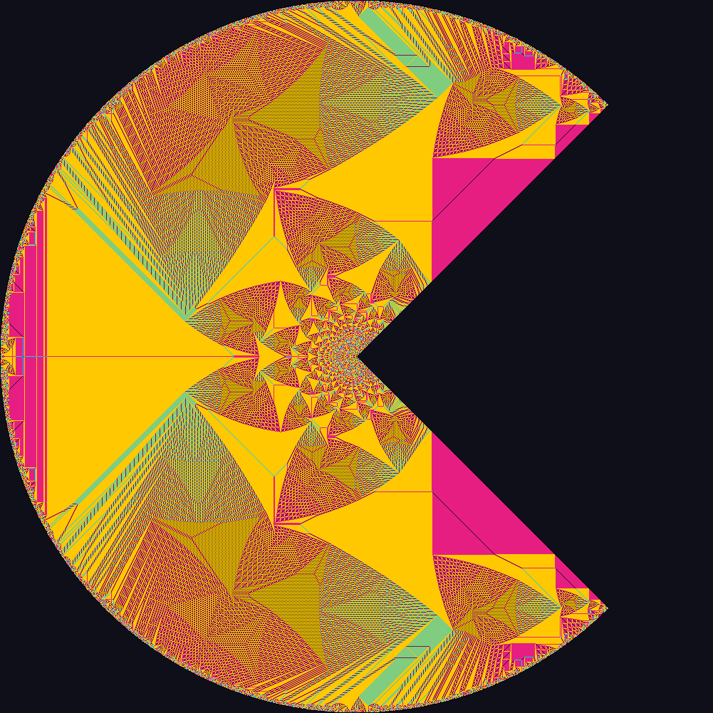

# Abelian Sandpile Artifact

Standard build instructions specified in the homework will still work.  You should run
the binary on any machine that has AVX-512, like the course VM.  No extra dependencies
are needed outside the standard Dockerfile.

However, you should run the following *before* timing the benchmark:

``` bash
export OMP_WAIT_POLICY=active
```

This will make OpenMP prefer a spin-wait over a sleep-wait, preventing odd timing
spikes.

For convenience, I have provided a copy of the benchmarking script I used for my report.
It runs a given grid size for at least 10 iterations, or until it has benchmarked over
at least 10 seconds. It will also time out if a given testcase takes more than 3 minutes
to run, after allowing the outstanding iteration to complete.

You can use this script as follows:

``` bash
#USAGE:
/benchmark.sh <SIZE>

# Example:
./benchmark.sh 300
```

The commits in the `main` branch interleave enhancements with bugfixes and
experimentation.  The features evaluated in my report have been ordered and consolidated
in the `features` branch of this repository. You can check that branch out, and the
instructions mentioned here should still apply.

Everything beyond this point is from the oriignal documentation.

# CS598APE HW3

This repository contains code for homework 3 of CS598APE. It is relatively
simple in comparison to HW1 and HW2 to ensure you have enough time to work on
the course project. 

`sandpile.c` contains the implementation of finding the identity element of a 2D
abelian sandpile.



*Identity sandpile on a 1001x1001 pacman grid*


To compile the program, run:

```bash
make all
```

To clean existing build artifacts, run:

```bash
make clean
```

Usage (after compiling):

```bash
./sandpile.exe <N> 
```

where `N` is the grid size

Consider speeding up the generation of this 1001x1001 identity sandpile (which
takes approximately ~3m 40s on my local laptop under the default setup)

```bash
./sandpile.exe 1001
```

For an optional, ungraded challenge, see how large a sandpile you can compute
on the course VMs and report the grid size and runtime. There is no prescribed
upper limit on `N` for this challenge.

