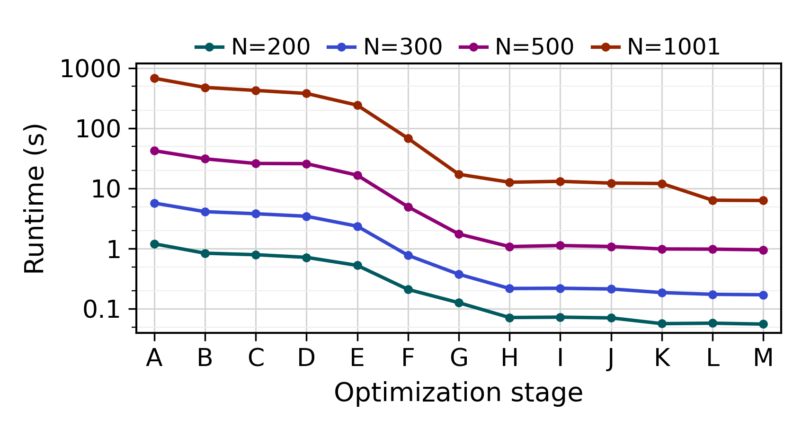

#+title: Optimizing Abelian Sandpile Stabilization
#+latex_class: sigplan
#+latex_class_options: [sigplan,screen,9pt]
#+options: author:nil date:nil

# --- acmart front matter -------------------------------------------------
#+latex_header: \author{Pradyun Narkadamilli}
#+latex_header: \email{pradyun2@illinois.edu}
#+latex_header: \setcopyright{none}
#+latex_header: \settopmatter{printacmref=false, printccs=false, printfolios=true}
#+latex_header: \renewcommand\footnotetextcopyrightpermission[1]{}
#+latex_header: \acmConference{CS598APE}{Fall 2026}{Urbana, IL}
#+latex_header: \captionsetup[figure]{skip=3pt}
#+latex_header: \setlength{\textfloatsep}{8pt plus 2pt minus 2pt}
#+latex_header: \setlength{\floatsep}{6pt plus 1pt minus 1pt}
#+latex_header: \setlength{\intextsep}{8pt plus 2pt minus 2pt}
#+latex_header: \setlength{\dbltextfloatsep}{6pt plus 1pt minus 1pt}
#+latex_header: \captionsetup[table]{skip=3pt}
#+latex_header: \setlength{\tabcolsep}{4pt}
#+latex_header: \setlength{\emergencystretch}{2em}
#+latex_header: \usepackage{enumitem}
#+latex_header: \setlist[enumerate]{nosep}
#+latex_header: \widowpenalty=500
#+latex_header: \clubpenalty=500
#+latex_header: \brokenpenalty=500

* Introduction
In Section [[Optimizations]], I describe each optimization I implemented.
Section [[Evaluation]] summarizes results across my optimizations. 
Finally, in Section [[Failed Optimizations]] I discuss some optimizations I tried that did not end up working.

I have published a copy of my code at: [[https://github.com/pradyungn/abelian-sands]].

Flamegraphs in early runs of the program showed that almost all of the runtime was spent in =find_identity()=, which is dominated of two expensive =stabilize()= calls.
Most of this homework was spent optimizing =stabilize()= by inspection and intuition, as =stabilize()= is a fairly shallow function.

* Optimizations
Performance data is all listed in Section [[Results]] to save space.
I instead state *geomean speedups* across the 4 test sizes (200, 300, 500, 1001) for brevity, as observed on the Course VM throughout testing..

Many of the optimizations rely on the AVX-512 extenion for x86 CPUs. 
This is available on the course VMs and most modern x86 CPUs, but not on ARM machines.

** Precompute Pac-Man Bounds
Though the stabilization function only needs to iterate within PacMan bounds, the way it does this in practice is by computing whether every point on the 2D grid falls within the bounds. This is expensive.

I hoisted this computation out of the loops by filling in the column bounds of each row in an array at the start of the program.
Though it can cause some misalignment in cache accesses, it significantly reduces the required number of integer operations.
Overall, this led to a 40.2% speedup over the baseline.

As a part of this feature addition I also reduced the data width of =grid= to 8-bit -- it did not affect runtime, but is a code addition exploited later on.
This is discussed more in Section [[Reducing Data Width to 8-bit]].

** Gather Formulation
The provided code implements a /scatter/ algorithm for stabilization, as a "toppled" cell updates itself /and/ the cells around it.
This makes it difficult to cleanly vectorize, and increases memory write count per-cell.
I instead used a /gather/ formulation, where each cell pulls the updates from its neighbors.

This is done in two logical passes:
1. Each cell topples, self-decrements, and writes its topple status into an auxiliary grid (=gridcond=) as a =bool=.
2. Once all the cells have written into =gridcond=, a second pass is done to let each cell "gather" contributions from its neighbors.

For simplicity, I modified the logic to /not/ update cells outside the Pac-Man bounds at all, while the original scatter-formulation can contribute sand bounds outside of the rim.
This slightly modifies the output image causing =diff= to fail to the provided reference, but looks identical by inspection.
I follow the convention that "sink" nodes outside of the sandpile bounds are held to 0 (as a ground).

In practice, I realized that at the end of each row-wise iteration to generate the topple status (=gridcond=), all of the sideways dependencies were already met for that row.
Each row undergoes two passes in the initial sweep to promote cacheline reuse, then the entire grid undergoes another pass to accumulate upwards/downwards contributions.

Since the code was now auto-vectorizable, I also turned on =-march=native=. This formulation led to an incremental speedup of 11.2%.

** =-flto= Flag
I turned on this compiler flag after doing the gather optimization.
Not necessarily predicated on prior performance, but it led to an incremental improvement of 8.4%.

** Manual Vectorization of First-Pass with AVX-512
The vectorized gather speedup did not seem as high as I expected.
Inspecting the auto-vectorization report, I realized that =gcc= had been conservative in vectorizing the loops in the gather formulation, and had only used 256-bit vectors at most.
=lscpu= showed that the Xeon CPUs supported 512-bit vectors, which could significantly reduce iteration count.

I split each of the loops in the initial pass -- that is, updating =gridcond= and accumulating left/right contributions -- into two loops with a shared iterator.
Vectors were used until the last 63 elements or less (since =grid= was changed to =int8_t=), at which point a normal iterator was used again.
This optimization led to a 48.2% incremental speedup.

Additionally, using the GCC flag to increase vector width (i.e =-mprefer-vector-width=512=) led to a slowdown over the previous auto-vectorized version.
I did not have a chance to inspect the disassembly at this phase, so I cannot make claims as to the exact reason why this flag was ineffective.
At this point, the program is /2.5x/ faster than the baseline.

** OpenMP Parallelization Over Row-Blocks
The gather formulation is mostly amenable to parallelization.
I modified the stabilize function to dispatch to a set of helpers which accepted a /range/ of rows instead of one-shotting the entire grid.
This is block-parallel, and was put under an OMP loop pragma.

I then added a "stitching" phase, wherein adjacent rows /across/ blocks could exchange contributions, after every thread was done with the initial block-topple phase..
This is done on a single core after all of the parallel threads have finished computing the toppled values of their block.

Evenly splitting the rows across the available threads (4 in the VM) led to an incremental speedup of 3.1x, the most significant so far.
I experimented with smaller block sizes, in hopes that it would help with cache locality on a single block, but this did not come to pass (and in fact led to slowdown).

** AVX-512 Intrinsics for Vertical Gathers
At this point I realized that I'd forgotten to use manual 512-bit intrinsics for the vertical gather that happens after the initial =gridcond= and sideways-contribution pass.
Splitting out the loops for this phase, in both the parallel threads and the stitching action, lead to an additional /2.49x/ speedup.

** Exploit AVX Mask Functions
Until now, each of the manually vectorized loops had two sections -- one using AVX-512 until within 64 elements of the end of the row, then another smaller loop.
Looking through the Intel intrinsics documentation [fn:docs], I found a set of /mask functions/ that could suppress loads and stores from invalid indices.
This eliminates the need for a trailing loop.

I instead created a mask on every loop iteration that guarded unused load-store lanes, preventing improper accumulates and loads.
This led to a /60.6% incremental speedup/, which was much larger than I was expecting at the time!

[fn:docs] https://www.intel.com/content/www/us/en/docs/intrinsics-guide/index.html

** Parallelizing Stitch
The stitch phase was the only "expensive" operation still running on a single core
Since the number of threads is equal to core count and unchanged across iterations, I elected to manually declare a parallel region and wrap each loop iteration of =stabilize= in a parallel pragma.
I then used OpenMP's barrier support to add a wait in between computing the block topples and the stitching phase.

Note that the openMP barrier implementation can occasionally lead to thread sleeps on barrier wait, spuriously increasing runtimes.
Benchmarks from this point were run with =OMP_WAIT_POLICY=active= set as an environment variable to guard against this.
Setting this environment variable treats the barrier as a spin-wait, improving wake-up latency at the cost of power.

Altogether, this led to a /slowdown/ of 2.5%, presumably since the overhead of the barrier was not worth parallelizing stitch. I'd initially set aside this feature, but it is required for the optimization in Section [[Unified Parallel Region]].

** Consolidated 2-Pass
This was a smaller optimization, where I realized that by adding shifted copies of the boolean vector being stored back into memory anyway, you could cover most of the left/right gather updates in a single pass anyway.
The only remaining elements were at the edge, and a set of halo elements at the edges of =gridcond= meant that they could be directly indexed for the starting/trailing elements.
I also realized that since the vector being stored into =grid= was being buffered anyway, part of the vertical gather pass could be done as a part of this initial forward pass as well, getting rid of some conditionals in phase 2.

This was a fairly modest improvement at /only 4%/ incrementally over the previous optimization, which /worsened/ performance. However, the largest testcase (1001) lost almost a half second compared to the performance in Section [[Exploit AVX Mask Functions]].
I imagine this is because the reduced dynamic instructions in each pass become more impactful as the input size grows.

#+CAPTION: Performance Improvements from Various Optimizations
#+NAME: tab:performance
#+ATTR_LATEX: :float multicolumn :placement [!t] :center t :booktabs t :font \footnotesize :align llrrrrrr|llrrrrrr
| ID | Feature            |   200 |   300 |    500 |    1001 | Speedup | Margin | ID | Feature            |   200 |   300 |   500 |   1001 | Speedup | Margin |
|----+--------------------+-------+-------+--------+---------+---------+--------+----+--------------------+-------+-------+-------+--------+---------+--------|
| A  | Baseline           | 1.211 | 5.753 | 42.739 | 682.995 |   1.000 |        | H  | AVX-512 Masks      | 0.072 | 0.219 | 1.088 | 12.772 |  31.039 |  1.606 |
| B  | Pre-Compute PacMan | 0.845 | 4.141 | 31.241 | 481.158 |   1.402 |  1.402 | I  | Parallelize Stitch | 0.073 | 0.221 | 1.133 | 13.208 |  30.295 |  0.976 |
| C  | Gather             | 0.797 | 3.822 | 26.198 | 428.525 |   1.562 |  1.114 | J  | Consolidate 2-Pass | 0.071 | 0.215 | 1.091 | 12.351 |  31.533 |  1.041 |
| D  | FLTO               | 0.720 | 3.470 | 25.989 | 381.556 |   1.693 |  1.084 | K  | Unified Parallel   | 0.057 | 0.187 | 0.993 | 12.156 |  35.457 |  1.124 |
| E  | AVX-512 (Sideways) | 0.530 | 2.374 | 16.723 | 243.755 |   2.509 |  1.482 | L  | Abuse Symmetry     | 0.058 | 0.175 | 0.986 |  6.410 |  42.196 |  1.186 |
| F  | OMP over Blocks    | 0.211 | 0.779 |  4.985 |  68.426 |   7.761 |  3.093 | M  | Pull-Only Stitch   | 0.056 | 0.172 | 0.961 |  6.351 |  43.127 |  1.022 |
| G  | AVX-512 (Vertical) | 0.127 | 0.377 |  1.761 |  17.304 |  19.322 |  2.490 |    |                    |       |       |       |        |         |        |

** Unified Parallel Region
To minimize the OMP costs from launching and closing parallel threads, I shifted all of the =find_identity= logic after the grid initialization into a single, unified parallel region.

The =stabilize= function calls into a =stabilize_kernel=, which represents a single stabilization pass. 
By changing the =changed= flag to a changed /epoch/, where in each thread sets it to whichever optimization iteration it is currently on.
This allows a single synchronization field to be shared across a stabilization pass without requiring an additional barrier to set it back to =false= at the beginning of a topple iteration.

Additionally, doing the inversion of grid cells on owned memory between stabilization passes means that data stays cache-resident (when working sets fully fit within the L2) rather than ping-ponging to another core for the update.

This optimization led to a 12% improvement, solely through coherency and plumbing changes -- the core algorithms were left unchanged.

** Abusing Symmetry on Odd Row Counts
When looking for resources on parallel abelian sandpile stabilization online, I found a blog post which discussed leveraging the eight-fold symmetry of a square to reduce the required stabilization region.
Since Pac-Man is symmetric around the centermost row, I tried to apply a similar method here.
By accumulating using the row /above/ the midpoint as a proxy for the data below it, one can entirely avoid stabilization on the bottom half of the grid.

When implemented, I noticed that this optimization /only/ worked when row-count was odd, and could not determine a viable heuristic to use in even-row cases.
I could not debug this so for now, the optimization is gated to only work on odd row counts.

I noticed some mild speedup in the even-row testcases, presumably because of some changes in heuristic evaluation that fell in my favor.
The largest testcase, 1001 rows, had its time /nearly halved/, from 12.156 seconds to 6.410, which is expected from the single axis of symmetry.

** Swapping out Stitch to Gather-Only
This is more of a "performance fix" than an optimization, but I thought it was an interesting one.
My initial implementation of stitch fetched the =grid= values for the uppermost row of a block and the lowermost row of the block above it, then accumulated the opposite row's =gridcond= values.
# This was convenient, as I could negotiate iteration bounds between these two rows and cover two block updates in a single pass.

I realized that it causes some unfortunate coherency behaviors when multithreaded.
The updating thread will invalidate a row's worth of =grid= data in another cache, read it, update it, then eventually have its own data invalidated to send this data back to the owner.
This round-trip is expensive.

I instead refactored the stitch to "pull" =gridcond= values for the first and last row of each block, rather than some other thread updating the last row of the owned block.
This creates some messier code and increases dynamic instruction count, as each thread now undergoes /two/ loops instead of one, but the write traffic is to data that is fully cache-resident.

This led to a small improvement of 2%, but the improvement was more pronounced as testcase size increased, even though thread count is identical.
This is likely since the ping-pong caused by stitching increases as a function of row size.

* Evaluation
** Methodology
All numbers were collected on the course VM.
To minimize noise, each benchmark is run for at least 10 iterations, or the minimum iteration count to hit 10 seconds (in order to smooth any transient noise).
The minimum runtime across these runs is the reported benchmark runtime.

Iterations are stopped if overall runtime exceeds 3 minutes at any point.
This provides coarse-grain estimates of runtime for long-running baselines while giving fairly accurate insight into parameters for the final version.

** Results

#+CAPTION: Runtime Improvement over Optimizations
#+NAME: fig:optimizations
#+ATTR_LATEX: :width 0.9\columnwidth :placement [thbp] :options trim=0 5 0 5,clip

The incremental and overall speedups of each optimization are shown in Table [[tab:performance]], and is visualized in Figure [[fig:optimizations]].

Overall, the final speedup achieved was by an order of 43.127x geometric mean across testcases.
Notably, the /delta/ between the different testcases significantly shrunk over time.
Initially, the 1001-row testcase was 563x /slower/ than the 200-row one.

At the end, this margin was reduced to a 113x slowdown.
This is less than ideal, as the working set has increased by only 25x from $N=200$ to $N=1001$, and the topple is (within a single pass at least) linear to workload size.
I imagine that with more time, I could get this bound closer to linear with working set size, though I am unsure if there is some closed-form property stating how the number of required stabilization iterations varies with grid size.

* Failed Optimizations
** Reducing Data Width to 8-bit
When I did the Pac-Man optimization, I also reduced the data width of the grid elements to 8-bit, as they should never be able to exceed even 16 in practice.
Though I thought this would improve cache hitrates, thereby improving performance, it did not end up having an ostensible effect on performance.

However, this optimization allowed vectorization to directly add the booleans to grid values for incrementation rather than requiring additional expansion of values into 32-bit.
It also allowed the AVX-512 vectors to contian 64 values per line instead of 16, significantly reducing iteration count.

This optimization was a failure in the sense that it did not lead to performance gain when first implemented, but was successful in facilitating /other/ optimizations.

** Vertical Iteration for Vertical Gathers
I tried on several occasions to do the Vertical gather by iterating in column-major order rather than row-major order, while still using.
My thought was that doing so wuold allow me to double-buffer =gridcond=, so that I would only require a single vector read for each progression.

This ended up being annoying and performance-losing for several reasons.
The first is that grid bounds are /different/ for the adjacent rows. As a result, each would require a different "valid mask" to mask off illegal or unnecessary load/stores.

Additionally, these masks are no longer aligned with the first element in a row.
My existing implementation starts with a fully hot mask (every load/store is done in the 64-element vector) until the last block of 64, at which point the trailing elements are truncated and set to 0.
Moving in column-major order requires picking a column as a fixed reference, thereby forcing the mask to shift relative to this point, which creates some messy expressions in every iteration.

I attempted this a few times, but the improved cache locality was never worth the increased complexity of double buffering.
I suspect that this is because the streaming patterns of this workload is highly predictable, so prefetchers are fairly good at running ahead of them as appropriate, ensuring the L1 hits on-demand.

L2 cache residency isn't much of a concern either.
Even the largest testcase, 1001 rows, requires only 250KB per thread for all of the owned state in =gridcond= and =grid= (~125 rows per thread, 100 elements per row, one byte per element).
Meanwhile, the Xeon L2 cache is /1MiB/ per core.

** Single-Pass Stabilize Kernel
Since the gather from upward elements was already shifted into the initial forward pass, the only contribution still required is from the downward element, which is admittedly non-causal.
I tried to fix this a few times by instead adopting a half-scatter within parallel blocks, and incrementing the materialized =gridcond= slice into the row below, even before it had been reached by the iterator.

However, this created some finnicky conditionals in the forward pass which required creating a /second/ load/store mask based on the grid bounds of the row above, such that state was not accumulated into cells outside of the Pac-Man radius (in adherence with my established model).
This led to slow-downs in several attempts -- the first time I tried, after implementing the optimization of Section [[Manual Vectorization of First-Pass With AVX-512]], led to slowdown of nearly a second in $N=500$!
